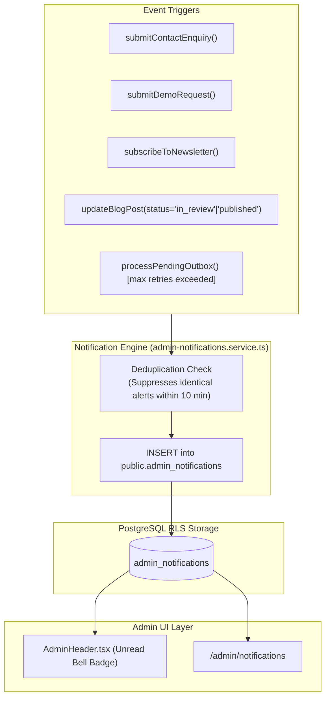

# Orbion Technologies — Administrative Notification Center

## 1. System Overview

The Admin Notification Center (`/admin/notifications`) provides an integrated in-portal alerting system for operational events, incoming customer inquiries, software demo requests, subscriber sign-ups, editorial review workflows, and platform delivery warnings.

---

## 2. Notification Architecture & Data Flow



---

## 3. Data Model (`admin_notifications`)

```sql
CREATE TABLE public.admin_notifications (
    id UUID PRIMARY KEY DEFAULT gen_random_uuid(),
    recipient_user_id UUID REFERENCES public.profiles(id) ON DELETE CASCADE,
    title TEXT NOT NULL,
    message TEXT NOT NULL,
    category TEXT NOT NULL CHECK (category IN (
        'lead',
        'demo',
        'newsletter',
        'email_failure',
        'cms',
        'system',
        'security'
    )),
    related_entity_type TEXT,
    related_entity_id UUID,
    link_url TEXT,
    read_at TIMESTAMPTZ,
    created_at TIMESTAMPTZ NOT NULL DEFAULT timezone('utc'::text, now())
);
```

### Key Field Design Rules:
- `recipient_user_id`: NULL signifies a system-wide broadcast visible to all `super_admin` and `admin` staff. A populated UUID restricts visibility to that specific staff member.
- `link_url`: Direct administrative path to navigate to the underlying record (e.g., `/admin/leads/[id]`, `/admin/blog/[id]/edit`).
- `read_at`: Timestamp indicating when the notification was acknowledged.

---

## 4. Alert Categories

| Category | Purpose | Example Event |
| :--- | :--- | :--- |
| `lead` | Inbound customer inquiry | "John Doe submitted: Enterprise AI Platform" |
| `demo` | Software product evaluation | "Sarah Connor requested demo for Orbion CRM" |
| `newsletter` | Subscriber opt-in | "user@example.com subscribed via website footer" |
| `email_failure`| Outbox delivery exhaustion | "Failed sending contact_notification to team" |
| `cms` | Editorial lifecycle state change | "Blog post 'Agent Architectures' submitted for review" |
| `system` | Background worker status | "Scheduled batch job executed successfully" |
| `security` | Administrative access event | "Role upgraded for administrator profile" |

---

## 5. Security & Privacy Guarantees

1. **User Notification Isolation**: Enforced via PostgreSQL Row Level Security (RLS). Non-admin staff (`sales`, `editor`, `hr`, `viewer`) can only query rows where `recipient_user_id = auth.uid()`.
2. **Alert Flood Suppression (Deduplication)**: When creating an alert tied to a `related_entity_id`, the engine checks whether an unread notification of the same category exists in the previous 10 minutes, preventing alert storms on retried actions.
3. **Sensitive Content Redaction**: Notifications contain summarized references rather than full confidential customer messages.

