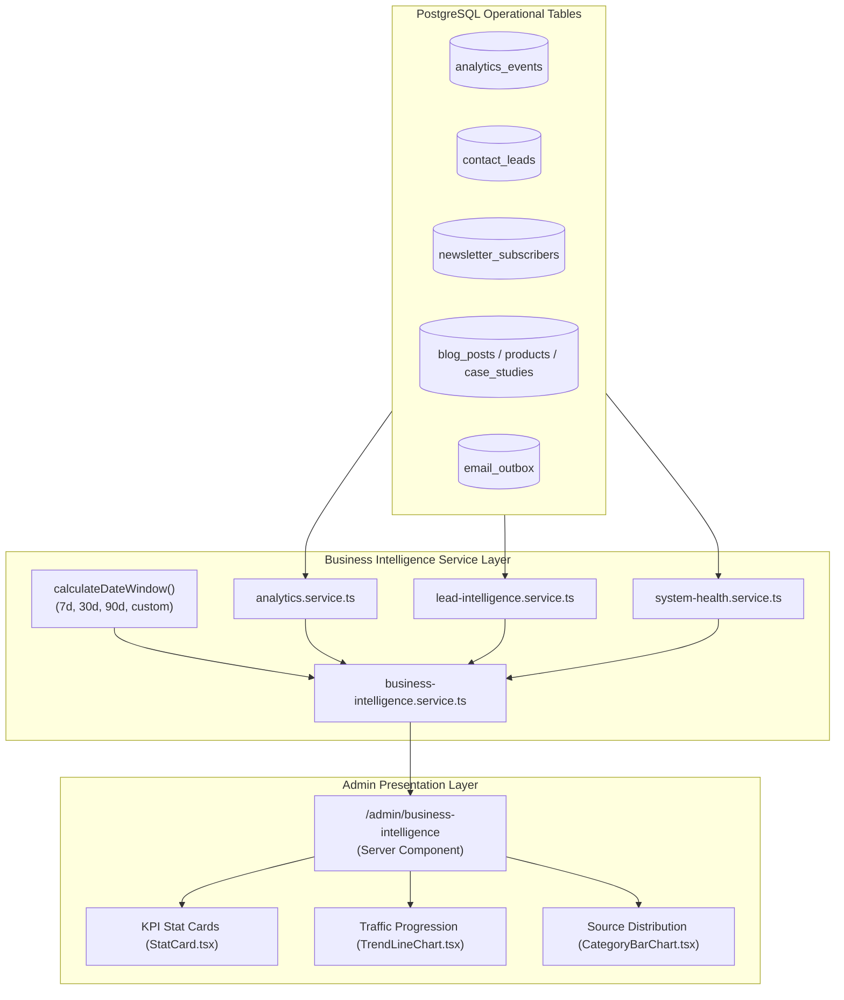

# Orbion Technologies — Business Intelligence Architecture

## 1. Executive Overview

The Business Intelligence (BI) Dashboard (`/admin/business-intelligence`) serves as the centralized executive operations hub for Orbion Technologies. It unifies real-time database-backed telemetry across five core business dimensions:
1. **Website Traffic & Engagement**: Genuine first-party page views, unique visitor counts, and popular content.
2. **Business Enquiries & Leads**: Volume of inbound leads, conversion stages, and source attribution.
3. **Newsletter Growth**: Active subscriber volume, new opt-in counts, and retention metrics.
4. **Content & Catalog Inventory**: Live blog publications, 7 planned SaaS products, and verified case studies.
5. **Platform Health & Outbox Queue**: Database latency, delivery success rates, and active operational alerts.

---

## 2. Architectural Data Flow

---

## 3. Metrics & Data Sources

| Domain | Key Metrics | Underlying Table | Calculation Method |
| :--- | :--- | :--- | :--- |
| **Website Traffic** | Total Views, Unique Visitors, Trends % | `analytics_events` | `count(id)` where `event_name = 'page_view'`; distinct `visitor_id` |
| **Inbound Leads** | Total Inquiries, New, Qualified, Closed | `contact_leads` | `count(id)` filtered by `status` within window; trend % vs previous period |
| **Newsletter** | Active Roster, New Opt-Ins, Net Growth | `newsletter_subscribers` | `count(id)` where `status = 'subscribed'` |
| **Content Health** | Published Posts, Drafts, Products, Studies | `blog_posts`, `products`, `case_studies` | Count by status; preserves 7 SaaS product inventory |
| **Operations** | Database Ping, Outbox Queue, Error Rate | `email_outbox`, `profiles` | Exact ping latency in ms; percentage of sent vs failed outbox jobs |

---

## 4. Date Window & Delta Arithmetic

Period comparisons calculate equivalent elapsed historical windows:
- **Last 7 Days (`7d`)**: Compares previous 7-day period `[now - 14d, now - 7d]` to current `[now - 7d, now]`.
- **Last 30 Days (`30d`)**: Compares previous 30-day period `[now - 60d, now - 30d]` to current `[now - 30d, now]`.
- **Last 90 Days (`90d`)**: Compares previous 90-day period `[now - 180d, now - 90d]` to current `[now - 90d, now]`.
- **Custom Range**: Measures exact calendar interval $\Delta t = \text{end} - \text{start}$ and shifts back by $\Delta t$ to compute honest baseline growth rates.

---

## 5. Visualizations & Design Standards

- **SVG Responsive Trendline**: Uses vector paths rendered in pure React with zero heavy third-party bundle bloat.
- **Orbion Brand Palette**: Styled strictly in accordance with design tokens (`#14342B` petrol, `#C36B3B` copper, `#FAF8F5` limestone).
- **Honest Empty States**: If no traffic or lead events occurred within a custom timeframe, clear, professional empty state indicators are displayed rather than synthetic or fabricated data.

