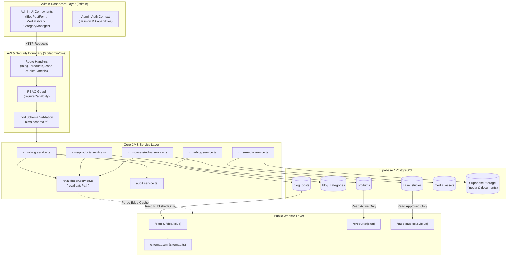

# Orbion Technologies — CMS Architecture

## 1. System Overview

The Orbion Technologies Content Management System (CMS) is natively embedded into the official Next.js 15 App Router architecture. Rather than relying on a decoupled third-party headless CMS or introducing separate infrastructure, the CMS leverages:
- **Database**: PostgreSQL hosted on Supabase with Row Level Security (RLS) enforcement.
- **Object Storage**: Supabase Storage with dedicated public (`media`) and private (`documents`) buckets.
- **Backend Services**: Next.js Server Components, API Route Handlers (`src/app/api/admin/cms/*`), and modular backend service layer (`src/services/cms-*.service.ts`).
- **Authorization**: Granular capability-based access control (`requireCapability`) extending Orbion's existing RBAC framework (`src/lib/auth/permissions.ts`).
- **Cache Management**: On-demand cache invalidation via `next/cache` (`revalidatePath`) ensuring instantaneous updates upon content publishing without full site redeployments.
- **Search Engine Optimization**: Dynamic metadata generation, OpenGraph/Twitter card tags, and dynamic sitemap (`src/app/sitemap.ts`) strictly indexing published content.

---

## 2. Architecture Diagram

---

## 3. Database Entities & Relationships

The database schema (`supabase/migrations/20261108000005_phase4_cms_and_storage.sql`) defines five primary tables:

### 1. `blog_categories`
- Categorization taxonomy for blog publications.
- **Fields**: `id` (UUID), `name` (TEXT), `slug` (TEXT UNIQUE), `description` (TEXT), `created_at`, `updated_at`.
- **Integrity**: Deletion is protected; categories associated with active posts cannot be deleted without post reassignment.

### 2. `blog_posts`
- Complete editorial post lifecycle with markdown content and SEO metadata.
- **Fields**: `id` (UUID), `title` (TEXT), `slug` (TEXT UNIQUE), `excerpt` (TEXT), `content` (TEXT), `featured_image` (TEXT), `category_id` (UUID FK -> `blog_categories`), `author_id` (UUID FK -> `profiles`), `status` (`ContentStatus`: `draft`, `in_review`, `published`, `archived`), `published_at` (TIMESTAMPTZ), `meta_title`, `meta_description`, `canonical_url`, `og_image`, `created_at`, `updated_at`.
- **Indexes**: `status`, `slug`, `published_at`, `category_id`, `author_id`.

### 3. `products`
- Official Orbion SaaS product registry and dynamic public landing page overrides.
- **Fields**: `id` (UUID), `name` (TEXT), `slug` (TEXT UNIQUE), `headline` (TEXT), `description` (TEXT), `status` (`ProductStatus`: `coming_soon`, `in_development`, `available`), `features` (JSONB Array), `target_audience` (TEXT), `pricing_hint` (TEXT), `sort_order` (INT), `created_at`, `updated_at`.
- **Initial Seed**: Seeded with all 7 official products (Orbion CRM, Orbion AI Chatbot, Orbion Bookings, Orbion Fit, Orbion Dine, Orbion Docs, Orbion Insights) all strictly defaulting to `coming_soon`.

### 4. `case_studies`
- Verified, approved enterprise implementation studies and business results.
- **Fields**: `id` (UUID), `title` (TEXT), `slug` (TEXT UNIQUE), `client_name` (TEXT), `industry` (TEXT), `challenge` (TEXT), `solution` (TEXT), `results` (JSONB Array), `metrics` (JSONB Object), `status` (`ContentStatus`), `published_at` (TIMESTAMPTZ), `featured_image`, `created_at`, `updated_at`.
- **Integrity**: Enforces zero fabricated testimonials. Clean, dignified empty state rendered on public site when no studies are published.

### 5. `media_assets`
- Registry tracking metadata for all files stored in Supabase Storage.
- **Fields**: `id` (UUID), `file_name` (TEXT), `file_path` (TEXT), `bucket` (`MediaBucket`: `media`, `documents`), `mime_type` (TEXT), `size_bytes` (BIGINT), `public_url` (TEXT), `uploaded_by` (UUID FK -> `profiles`), `alt_text` (TEXT), `created_at`, `updated_at`.

---

## 4. Public Content Rendering Layer

1. **Strict Query Segregation**:
   Public reader pages (`/blog/[slug]`, `/case-studies/[slug]`, `/products/[slug]`) execute queries explicitly filtered by `status = 'published'`. Unpublished drafts and review items return `notFound()` (404 HTTP status).
2. **Dynamic Next.js 15 Params Resolution**:
   All dynamic route parameters adhere to the asynchronous contract (`const { slug } = await props.params`).
3. **On-Demand Revalidation (`revalidatePath`)**:
   Publishing, editing, or archiving triggers background invalidation of edge and ISR caches:
   - `/blog`, `/blog/[slug]`
   - `/products/[slug]`
   - `/case-studies`, `/case-studies/[slug]`
   - `/sitemap.xml`
4. **Resilient Public Asset Fallback**:
   User-uploaded images dynamically served via Supabase Storage include fallbacks and bypass Next.js image domain optimization restrictions when required, ensuring broken external images do not disrupt page rendering.

