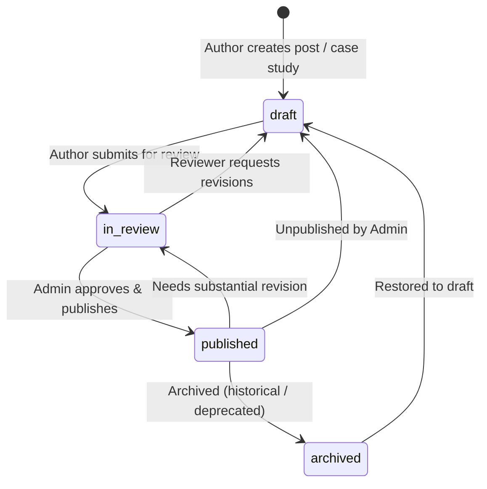

# Orbion Technologies — CMS Content Publishing Workflow

## 1. Publishing Lifecycle Overview

Content in the Orbion CMS traverses a 4-stage deterministic state machine designed to ensure brand alignment, legal accuracy, and SEO readiness before public exposure.

---

## 2. State Definitions & Transitions

| State | Public Visibility | Who Can Transition To It? | Description |
| :--- | :---: | :--- | :--- |
| `draft` | ❌ Never | Author (`editor`, `admin`, `super_admin`) | Work in progress. Saved privately. Not visible on public website or sitemap. |
| `in_review` | ❌ Never | Author (`editor`, `admin`, `super_admin`) | Flagged for editorial and technical review. Pending sign-off. |
| `published` | ✅ Immediate | `admin`, `super_admin` only | Live on public website (`/blog`, `/case-studies`), included in dynamic `/sitemap.xml`, indexed by search engines. |
| `archived` | ❌ Never | `admin`, `super_admin` only | Deprecated or superseded content. Preserved in database for compliance and auditing, but unlisted publicly. |

---

## 3. Step-by-Step Publishing Journey

### Phase 1: Authoring & Drafting
1. An `editor` navigates to `/admin/blog/new`.
2. The author inputs the title, URL slug (auto-sanitized), category, excerpt, featured image URL, and markdown content.
3. The editor provides targeted SEO metadata:
   - Meta title (defaults to post title if blank)
   - Meta description (defaults to excerpt if blank)
   - Canonical URL
   - OpenGraph preview image
4. The live markdown editor side-by-side preview allows formatting verification (headings, code blocks, quotes, lists).
5. Saving persists the item in `draft` status.

### Phase 2: Submission for Review
1. Once completed, the author changes status to `in_review`.
2. The item appears in the administrative post index under the "In Review" filter badge.
3. Editors cannot publish directly; attempting to publish triggers a 403 Forbidden rejection.

### Phase 3: Editorial Review & Approval
1. An `admin` or `super_admin` opens `/admin/blog/[id]/edit`.
2. The administrator reviews the content, validates claims, checks formatting, and evaluates SEO tags.
3. If revisions are required, the administrator sets the status back to `draft` with feedback.
4. If approved, the administrator selects `published` and clicks "Publish".

### Phase 4: Automated Edge Invalidation (`revalidatePath`)
1. Upon transitioning to `published` (or `archived` / `draft`), the server invokes `revalidateContentPaths()`:
   - Invalidation of post detail page (`/blog/[slug]`)
   - Invalidation of blog listing directory (`/blog`)
   - Invalidation of dynamic sitemap (`/sitemap.xml`)
2. Public visitors immediately receive the newly generated content on their next request.

---

## 5. Audit Logging of Transitions

Every state change automatically logs an event in the immutable `audit_logs` table:
- `action`: `BLOG_POST_UPDATED`, `BLOG_POST_PUBLISHED`, or `BLOG_POST_ARCHIVED`
- `actor_id`: UUID of the authenticated administrator
- `target_type`: `blog_posts`
- `details`: Records previous state, new state, title, and slug

