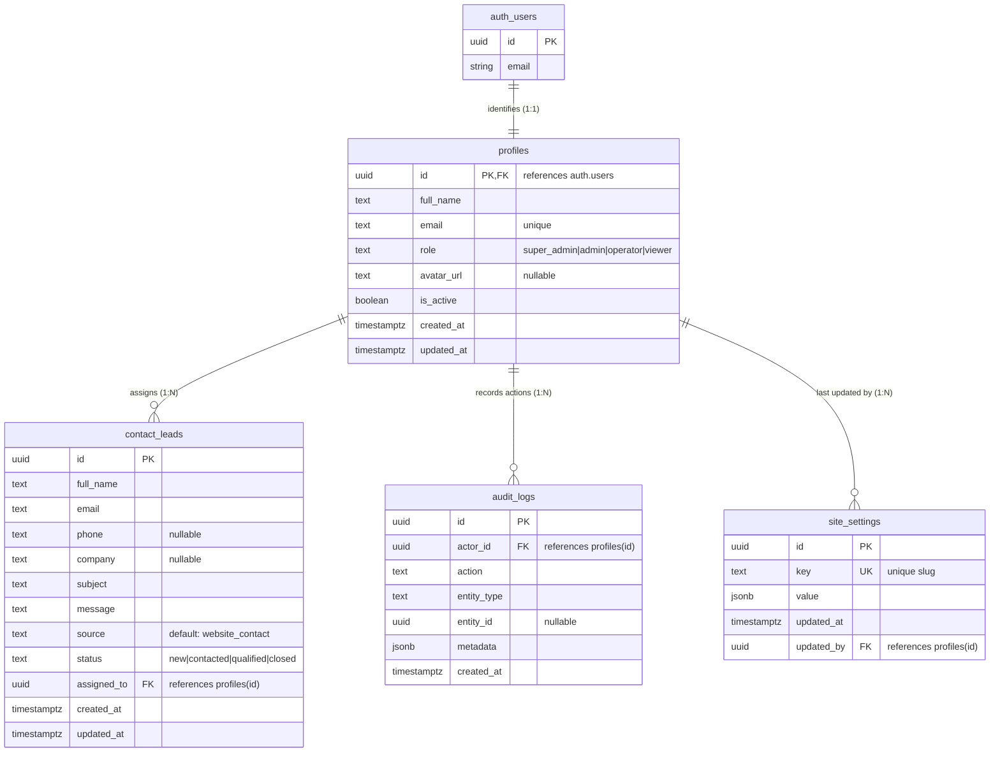

# Orbion Technologies — Core Database Schema Specification
**Document Version:** 1.0.0  
**Phase:** Phase 1 (Backend Foundation & Database Architecture)  
**Database Engine:** PostgreSQL 15+ (Supabase)  
**Status:** Approved  

---

## 1. Schema Overview

The initial database schema establishes four core tables required to support the company website's contact lifecycle, administrative access control, security auditing, and system configuration.

---

## 2. Table Specifications

### 2.1 `public.profiles`
Represents internal administrators, engineers, and support operators. Tied directly to Supabase Auth's `auth.users` table.

| Column | Type | Constraints | Default | Description |
|---|---|---|---|---|
| `id` | `UUID` | `PRIMARY KEY`, `REFERENCES auth.users(id) ON DELETE CASCADE` | None | Corresponds to authenticated user identity. |
| `full_name` | `TEXT` | `NOT NULL`, `CHECK (2 <= length <= 120)` | None | Operator full name. |
| `email` | `TEXT` | `NOT NULL`, `UNIQUE`, Valid email format check | None | Work email address. |
| `role` | `TEXT` | `NOT NULL`, `CHECK IN ('super_admin', 'admin', 'operator', 'viewer')` | `'operator'` | Role for RBAC authorization. |
| `avatar_url` | `TEXT` | `NULLABLE`, Valid HTTPS URL check | `NULL` | Profile picture asset URL. |
| `is_active` | `BOOLEAN` | `NOT NULL` | `true` | Account active state toggle. |
| `created_at` | `TIMESTAMPTZ` | `NOT NULL` | `timezone('utc', now())` | Creation timestamp. |
| `updated_at` | `TIMESTAMPTZ` | `NOT NULL` | `timezone('utc', now())` | Last modified timestamp (trigger). |

**Indexes:**
- `idx_profiles_role`: `profiles(role)`
- `idx_profiles_is_active`: `profiles(is_active)`
- `idx_profiles_email`: `profiles(email)`

---

### 2.2 `public.contact_leads`
Stores visitor and enterprise inquiries submitted through the Orbion Technologies website.

| Column | Type | Constraints | Default | Description |
|---|---|---|---|---|
| `id` | `UUID` | `PRIMARY KEY` | `gen_random_uuid()` | Unique lead identifier. |
| `full_name` | `TEXT` | `NOT NULL`, `CHECK (2 <= length <= 120)` | None | Visitor full name. |
| `email` | `TEXT` | `NOT NULL`, Valid email regex check | None | Visitor work or personal email. |
| `phone` | `TEXT` | `NULLABLE`, `CHECK (length <= 30)` | `NULL` | Optional contact telephone number. |
| `company` | `TEXT` | `NULLABLE`, `CHECK (length <= 120)` | `NULL` | Company or organization name. |
| `subject` | `TEXT` | `NOT NULL`, `CHECK (2 <= length <= 120)` | None | Enquiry category/topic. |
| `message` | `TEXT` | `NOT NULL`, `CHECK (10 <= length <= 5000)` | None | Full text inquiry message. |
| `source` | `TEXT` | `NOT NULL`, `CHECK (length <= 80)` | `'website_contact'` | Acquisition channel or route. |
| `status` | `TEXT` | `NOT NULL`, `CHECK IN ('new', 'contacted', 'qualified', 'closed')` | `'new'` | Lead processing stage. |
| `assigned_to`| `UUID` | `NULLABLE`, `REFERENCES public.profiles(id) ON DELETE SET NULL` | `NULL` | Assigned team member. |
| `created_at` | `TIMESTAMPTZ` | `NOT NULL` | `timezone('utc', now())` | Submission timestamp (UTC). |
| `updated_at` | `TIMESTAMPTZ` | `NOT NULL` | `timezone('utc', now())` | Last modified timestamp (trigger). |

**Indexes:**
- `idx_contact_leads_email`: `contact_leads(email)`
- `idx_contact_leads_status`: `contact_leads(status)`
- `idx_contact_leads_created_at`: `contact_leads(created_at DESC)`
- `idx_contact_leads_assigned_to`: `contact_leads(assigned_to) WHERE assigned_to IS NOT NULL`

---

### 2.3 `public.audit_logs`
An append-only security ledger recording critical operations. Modification and deletion are strictly prohibited by database policy.

| Column | Type | Constraints | Default | Description |
|---|---|---|---|---|
| `id` | `UUID` | `PRIMARY KEY` | `gen_random_uuid()` | Unique log entry ID. |
| `actor_id` | `UUID` | `NULLABLE`, `REFERENCES public.profiles(id) ON DELETE SET NULL` | `NULL` | ID of operator performing action. |
| `action` | `TEXT` | `NOT NULL`, `CHECK (2 <= length <= 100)` | None | Action identifier (e.g., `lead.assigned`). |
| `entity_type`| `TEXT` | `NOT NULL`, `CHECK (2 <= length <= 80)` | None | Target entity table/domain. |
| `entity_id` | `UUID` | `NULLABLE` | `NULL` | Primary key of target entity. |
| `metadata` | `JSONB` | `NOT NULL` | `'{}'::jsonb` | Sanitised operational metadata. |
| `created_at` | `TIMESTAMPTZ` | `NOT NULL` | `timezone('utc', now())` | Event occurrence timestamp. |

**Indexes:**
- `idx_audit_logs_actor_id`: `audit_logs(actor_id)`
- `idx_audit_logs_entity`: `audit_logs(entity_type, entity_id)`
- `idx_audit_logs_created_at`: `audit_logs(created_at DESC)`
- `idx_audit_logs_action`: `audit_logs(action)`

---

### 2.4 `public.site_settings`
Non-secret runtime configuration parameters and feature flags.

| Column | Type | Constraints | Default | Description |
|---|---|---|---|---|
| `id` | `UUID` | `PRIMARY KEY` | `gen_random_uuid()` | Setting ID. |
| `key` | `TEXT` | `NOT NULL`, `UNIQUE`, Slug regex `^[a-z0-9_.-]+$` | None | Machine-readable setting key. |
| `value` | `JSONB` | `NOT NULL` | `'{}'::jsonb` | Arbitrary JSON configuration payload. |
| `updated_at` | `TIMESTAMPTZ` | `NOT NULL` | `timezone('utc', now())` | Last modified timestamp. |
| `updated_by` | `UUID` | `NULLABLE`, `REFERENCES public.profiles(id) ON DELETE SET NULL` | `NULL` | Last modifying operator. |

**Indexes:**
- `idx_site_settings_key`: `site_settings(key)`

---

## 3. Row Level Security & Access Matrix

| Table | Anonymous (`anon`) | Authenticated (`authenticated`) | Service Role (`service_role`) |
|---|---|---|---|
| `contact_leads` | ❌ None (No SELECT/INSERT/UPDATE/DELETE) | ✅ SELECT (Active staff) ✅ UPDATE (Status/assign) ❌ DELETE (Super admins only) | ✅ Full access (Used by server ingestion API) |
| `profiles` | ❌ None | ✅ SELECT (Self or Admin) ✅ UPDATE (Self details, no role change) | ✅ Full access |
| `audit_logs` | ❌ None | ✅ SELECT (Admins only) ❌ INSERT / UPDATE / DELETE | ✅ Full access (Write-only ledger) |
| `site_settings` | ❌ None | ✅ SELECT (Active staff) ✅ INSERT/UPDATE (Admins only) | ✅ Full access |

---

## 4. Deletion & Retention Rules
- **Cascade Deletion:** Used solely on `profiles.id -> auth.users.id`. Deleting an auth user removes their corresponding staff profile.
- **Set Null Deletion:** Historical records in `contact_leads.assigned_to`, `audit_logs.actor_id`, and `site_settings.updated_by` reference `profiles(id)` with `ON DELETE SET NULL`. If an operator leaves the organization, historical leads and audit logs remain intact for compliance.

