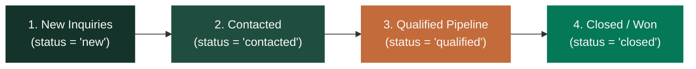

# Orbion Technologies — Lead Intelligence Architecture

## 1. Overview & Source of Truth

The Lead Intelligence module (`/admin/lead-intelligence`) provides real-time sales operations reporting on top of the established `contact_leads` table. It does not introduce a secondary CRM, duplicate tables, or modify existing workflows.

### Source of Truth Guarantee:
All intelligence metrics query the primary `public.contact_leads` table directly. The check constraint established in Phase 1 and Phase 3 is strictly preserved:
```sql
CHECK (status IN ('new', 'contacted', 'qualified', 'closed'))
```

---

## 2. Inbound Funnel Metrics

The conversion funnel models the four operational stages of customer inquiries:



- **New Inquiries**: Fresh inquiries awaiting initial triage or assignment by staff.
- **Contacted**: Preliminary customer contact or response dispatched.
- **Qualified**: High-intent opportunities with budget, timeline, and requirement fit.
- **Closed / Won**: Successfully converted engagements or resolved inquiries.
- **Qualification Rate**: Computed honestly as $\frac{\text{Qualified} + \text{Closed}}{\text{Total Inquiries}} \times 100\%$.

---

## 3. Dimensions of Analysis

1. **Inquiry Subject Taxonomy**: Aggregates customer topics (AI Operating System, Intelligent Software, Custom Workflow Automation, Enterprise Partnerships).
2. **Inbound Source Attribution**: Tracks acquisition channels (`website_contact`, `website_footer`, partner referrals).
3. **Staff Workload Allocation**: Aggregates assigned inquiries by staff profile (`profiles.full_name`) to balance team workload.
4. **Monthly Intake Trend**: Identifies month-over-month growth patterns in customer interest.

---

## 4. Secure Lead CSV Export

Located at `/api/admin/lead-intelligence/export`:
- **Server Authorization**: Guarded by `reports:export` and `lead_intelligence:view`.
- **Formula Injection Defense (CWE-1236)**: Every cell is sanitized with `sanitizeCsvCell` (neutralizing `=`, `+`, `-`, `@`).
- **Internal Notes Isolation**: Confidential internal staff commentary (`lead_notes`) is omitted from external exports.
- **Audit Ledger**: Dispatches an immutable record to `audit_logs` logging the requesting administrator's ID, date range, row count, and applied status filters.

