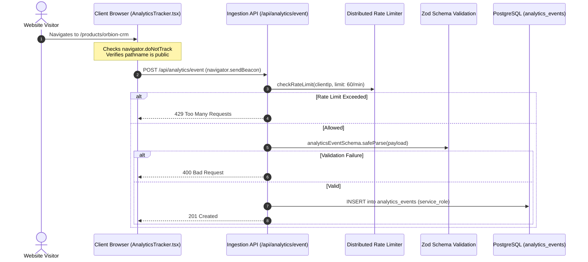

# Orbion Technologies — First-Party Website Analytics Architecture

## 1. Overview & Privacy Principles

Orbion Technologies implements **privacy-conscious, first-party analytics** designed to understand visitor engagement, popular software product interest, and conversion funnels without compromising user privacy or violating global regulations (GDPR, CCPA, ePrivacy).

### Core Privacy Guarantees:
1. **Zero Third-Party Trackers**: No Google Analytics, Meta Pixel, or commercial ad network scripts are installed.
2. **Zero Fingerprinting**: Canvas fingerprinting, audio context probing, and persistent hardware hashes are strictly prohibited.
3. **Strict "Do Not Track" Respect**: If a visitor has enabled `navigator.doNotTrack === "1"`, event tracking is completely bypassed client-side.
4. **No Sensitive PII Collection**: Form message contents, phone numbers, passwords, and full IP addresses are never transmitted or stored in the analytics database.
5. **Internal Route Exclusion**: Internal administrative portals (`/admin/*`) and API endpoints (`/api/*`) are excluded from public analytics metrics.

---

## 2. Event Ingestion Pipeline



---

## 3. Supported Analytics Events

| Event Name | Trigger Context | Associated Dimensions |
| :--- | :--- | :--- |
| `page_view` | Generic public page visits | `page_path`, `device_category`, `browser_category`, `utm_source` |
| `product_view` | Visits to `/products/[slug]` | Product slug in `page_path`, referrer domain |
| `blog_view` | Visits to technical articles (`/blog/[slug]`) | Article slug, referrer domain |
| `contact_visit` | Visits to the `/contact` portal | Inbound entry point for business leads |
| `contact_submit` | Successful contact inquiry submission | Form reference tracking |
| `demo_submit` | Software evaluation demo request | Targeted product identifier |
| `newsletter_submit`| Newsletter opt-in confirmation | Source attribution (`website_footer`, etc.) |

---

## 4. Stored Analytics Schema

```sql
CREATE TABLE public.analytics_events (
    id UUID PRIMARY KEY DEFAULT gen_random_uuid(),
    event_name TEXT NOT NULL,
    page_path TEXT NOT NULL,
    referrer_domain TEXT,
    visitor_id TEXT NOT NULL,
    session_id TEXT NOT NULL,
    device_category TEXT NOT NULL DEFAULT 'unknown',
    browser_category TEXT,
    utm_source TEXT,
    utm_medium TEXT,
    utm_campaign TEXT,
    metadata JSONB NOT NULL DEFAULT '{}'::jsonb,
    created_at TIMESTAMPTZ NOT NULL DEFAULT timezone('utc'::text, now())
);
```

---

## 5. Administrative Analytics Portal

Located at `/admin/analytics`:
- **KPI Telemetry**: Total page views, unique visitors (pseudonymous count), sessions, and conversion action volume.
- **Traffic Progression**: Daily trend visualization tracking daily view patterns.
- **Top Destinations**: Table of highest-traffic URLs.
- **Referrer Attribution**: Top referring external domains.
- **Device Viewports**: Categorized breakdown between desktop, mobile, and tablet viewports.

