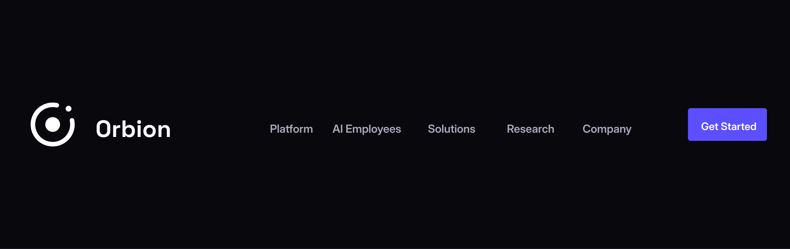

# Orbion Brand Assets

This repository contains Orbion logo, symbol, favicon, app-icon, and mockup files for use across digital products and brand materials.

## Repository contents

| Folder | Contents |
|---|---|
| [`SVG Images/`](./SVG%20Images/) | 11 vector assets, including horizontal and stacked logos, symbols, and Orbion Technologies logo variants |
| [`PNG Images/`](./PNG%20Images/) | 23 raster assets, including logos, symbols, a 1024 × 1024 app icon, and a 512 × 512 favicon |
| [`Favicon/`](./Favicon/) | Seven favicon PNGs sized 16, 32, 48, 64, 128, 256, and 512 pixels square |
| [`Mockups/`](./Mockups/) | Navbar usage preview |

### Navbar preview



## Choosing an asset

- **Websites and responsive interfaces:** Prefer an SVG from `SVG Images/` when the platform supports SVG. Use a matching PNG when a raster image is required.
- **Horizontal layouts:** Use `orbion-logo-horizontal.svg` or one of the `orbion-logo*.png` files.
- **Compact or square layouts:** Use `orbion-logo-stacked.svg` or an `orbion-logo-stacked-*.png` file.
- **Symbol-only placements:** Choose an `orbion-symbol*.svg` or `orbion-symbol*.png` file.
- **Orbion Technologies branding:** Use the `orbion-technologies-logo*` files.
- **Favicons:** Select the PNG matching the target pixel size from `Favicon/`, or use `orbion-favicon.svg` for SVG support.
- **App icons:** Use `orbion-app-icon.svg` or `orbion-app-icon-1024.png`.

The filenames distinguish available dark, light/white, monochrome, transparent, and compact variations. Check the asset against its intended background before use.

## Example: use the favicon PNGs

```html
<link rel="icon" type="image/png" sizes="16x16" href="/Favicon/orbion-favicon-16.png">
<link rel="icon" type="image/png" sizes="32x32" href="/Favicon/orbion-favicon-32.png">
<link rel="icon" type="image/png" sizes="48x48" href="/Favicon/orbion-favicon-48.png">
```

For static-site or web-app projects, copy the required files into the app's public/static assets directory and update the paths to match the deployment.

## Usage notes

- Preserve the logo and symbol proportions; do not stretch, crop, rotate, recolor, or add effects.
- Keep adequate clear space around each mark and use a version with suitable contrast for its background.
- Prefer SVG for scalable output and PNG for applications that require raster files.
- PNGs are provided at high resolutions for downscaling; avoid enlarging small favicon variants.
